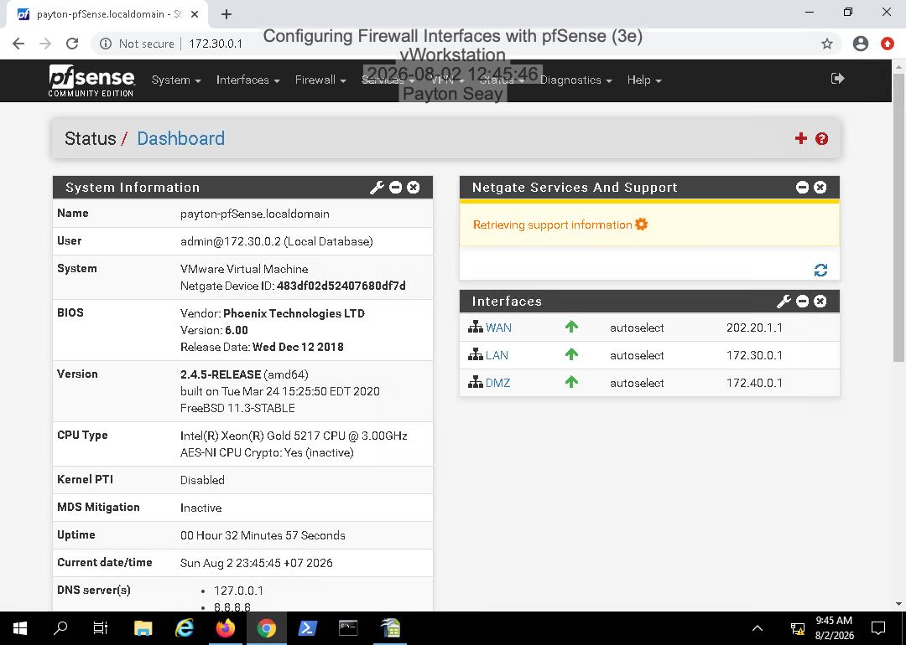
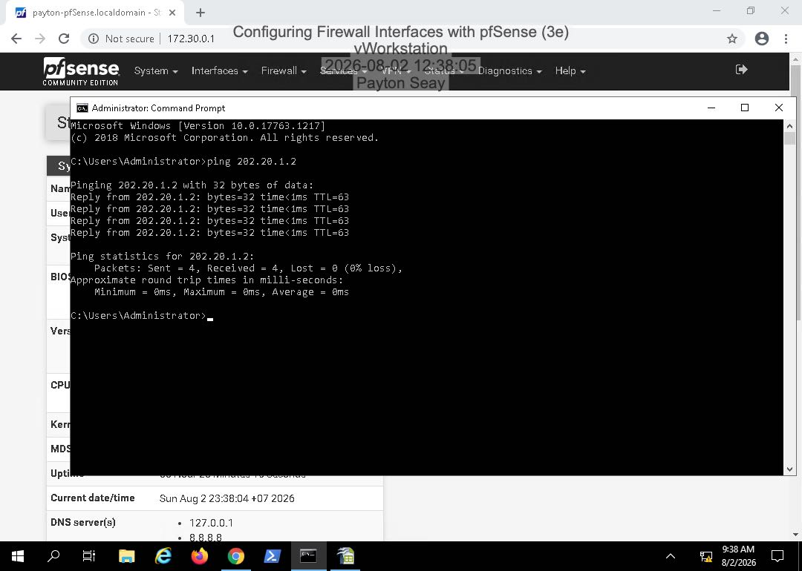
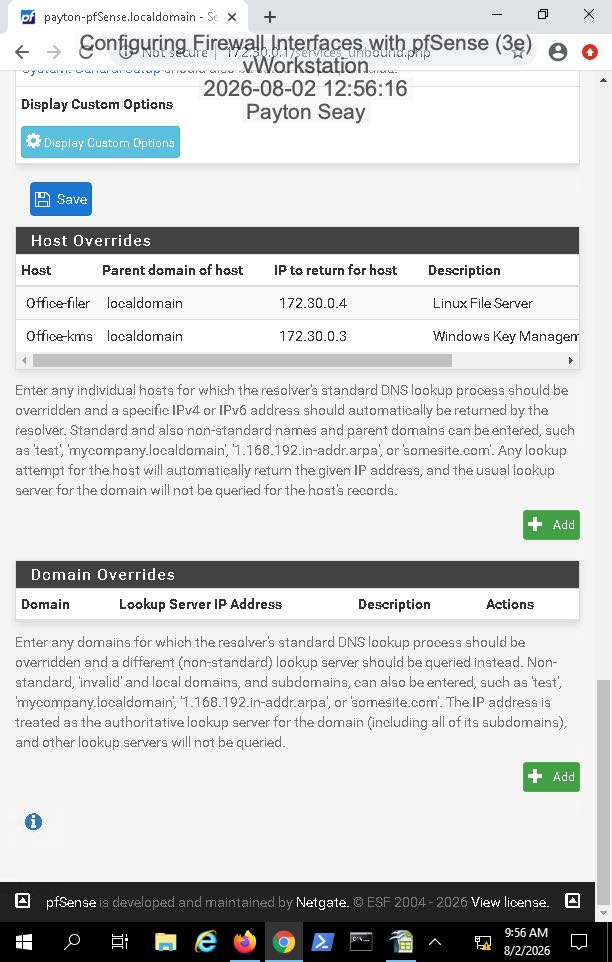
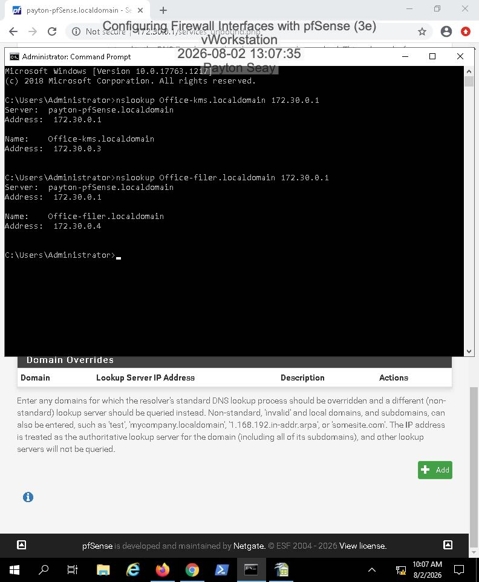
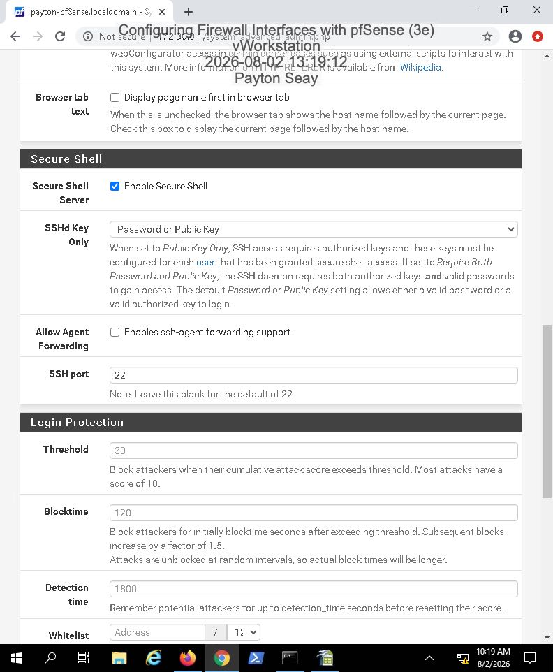
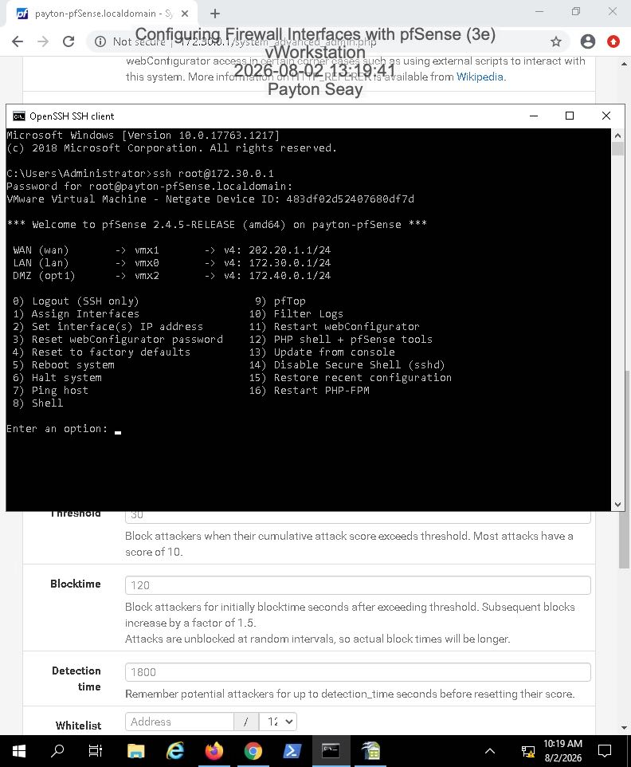

# pfSense Firewall Configuration and Network Segmentation

## Project Overview
This academic lab focused on configuring and verifying firewall interfaces using pfSense in a virtualized network environment. I configured WAN, LAN, and DMZ interfaces, tested network connectivity, configured split DNS, and enabled SSH remote access.

## Tools and Technologies
- pfSense
- Virtual Machines
- TCP/IP
- ICMP / Ping
- DNS / nslookup
- SSH

## Project Objectives
- Configure WAN and LAN firewall interfaces.
- Add a DMZ interface.
- Verify connectivity using ICMP tests.
- Configure split DNS with DNS Resolver host overrides.
- Verify DNS resolution with nslookup.
- Enable and test SSH remote access.

## Configuration and Testing

### 1. WAN and LAN Interfaces
Configured the WAN and LAN interfaces and verified their status on the pfSense dashboard.

### 2. DMZ Interface
Configured a DMZ interface to support network segmentation and verified its status.

### 3. Connectivity Testing
Used ICMP requests to verify connectivity between configured network interfaces and the upstream gateway.

### 4. Split DNS Configuration
Created DNS Resolver host overrides for internal systems and verified name resolution using nslookup.

### 5. SSH Remote Access
Enabled SSH on pfSense and verified a successful remote connection.

## Results
- Configured WAN, LAN, and DMZ interfaces.
- Verified network connectivity using ICMP.
- Successfully resolved configured DNS hostnames.
- Established SSH access to pfSense.

## Skills Demonstrated
- Firewall administration
- Network interface configuration
- Network segmentation concepts
- DNS troubleshooting
- SSH remote administration
- Network connectivity verification

## What I Learned
This lab strengthened my understanding of how firewall interfaces, DNS, and remote access work together in a network environment. It also gave me hands-on experience verifying configurations and troubleshooting connectivity.

## Project Context
Completed as an academic hands-on lab for Network Security, Firewalls, and VPNs.
  
